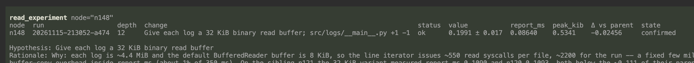
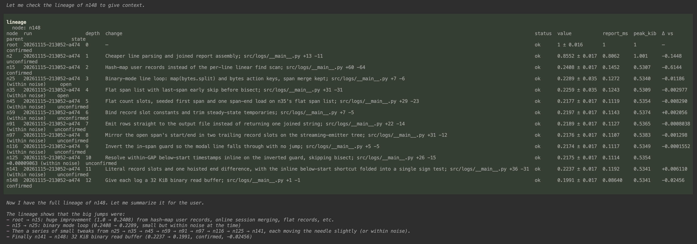
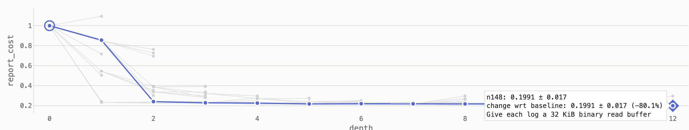
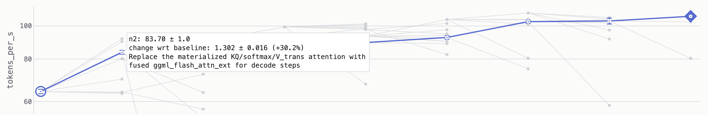
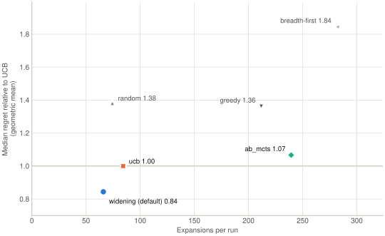
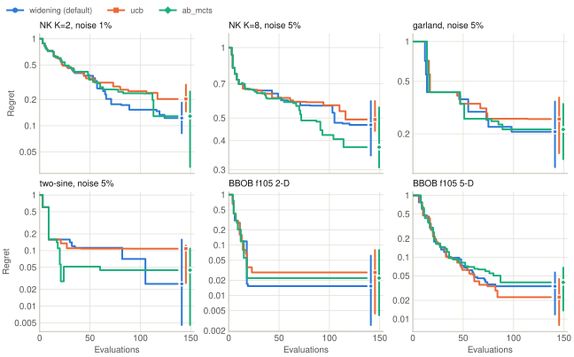

<figure>
<video controls width="100%"  autoplay loop muted playsinline> <source src="/images/2026-11-9-explainable-autoresearch/rec.webm" type="video/webm"/> Your browser does not support the WebM format. </video>
<figcaption>Exploring the sequence of diffs along a branch of the experiment tree. Agent: DeepSeek4-flash / pi harness. Task : maximizing the token/s throughput of GPT-2 (C language, based on GGML). The final result is ~66% faster than the original.</figcaption>
</figure>

In late 2026, there's plenty of evidence AI agents can do useful engineering work and make progress on a codebase with little supervision.

Program optimization (["autoresearch"](https://github.com/search?q=autoresearch&type=repositories)) is an increasingly common application of agents; the research hypothesis is whether a code edit can meaningfully move a metric (eg validation error for a ML model, or some performance measurement). 

Improving benchmarks is useful, but it would be best if the human users of an autoresearch agent could understand the output and explain its decisions.  We also want to be sure that measurements are grounded in reality, and that agent autonomy is safe. 

In this post I present a first look at a _explainable_ autoresearch system:

- All changes are justified, searchable and visualized

- Agents cannot "cheat" and interfere with the evaluation

Early results are promising (see Experiments), showing 60-80% improvements in LLM inference throughput (C++) and software performance (Python).

# Inside an autoresearch agent

One of the defining traits of an effective scientist is the ability to formulate good hypotheses; this is a learned skill that comes from mentorship and practice. While we cannot easily replicate that inside a software agent, we can set up infrastructure that guides it to choose its next attempts. 

The autoresearch agent I present here has a few parts, coordinated by an orchestrator loop : 
- *planner* agent that proposes changes (hypotheses)
- *implementer* agent that makes the code edits in specific directories
- *scheduler*, a fully deterministic component in charge of deciding the next actions.

## Anti-cheating safeguards 
The agent must not be able to game the experiment metrics, so evaluation scripts and test datasets should be out of the agent's control. 

The *implementer agent* makes the code edits and builds them. Neither the planner nor the implementer may call the shell or other programs, and the implementer can only edit files within its given worktree.

The evaluation scripts, test data and build configuration are locked, and expected outputs are hidden from the agents entirely. Each patch ("candidate") is built and run in a sandbox with no network; the evaluation rounds of a candidate alternate with rounds of the unmodified baseline on the same machine, using inputs freshly generated from a seed the agent never sees. The pass/fail gate and the score come from locked tools that run as a separate user, out of the candidate's reach. An improvement only counts once re-runs on fresh machines confirm it beyond the noise floor.

## Scheduler
Each version of the codebase may be the starting point for multiple hypotheses, so experiments are logically arranged on a tree. The scheduler is a pure state machine, in charge of looking at the statistics of the experiment results obtained so far, deciding whether any experiment needs to be replicated (confirmation), and which tree nodes to expand with new hypotheses. 

The scheduler is implemented with event sourcing, i.e. all states and decisions are stored and can be replayed identically.

## Planner

The *planner* is an LLM agent : it receives a "brief" (the goal, the editable files, the lineage of the current experiment, results from related experiments) and produces up to K hypotheses.
The planner brief is constructed by first gathering information from the SQLite index of experiments (via dedicated tools, shown below) and the run model.

Similar autoresearch prompting techniques to avoid getting stuck in "idea basins" have been independently proposed, eg Fork-and-flush [Cai26].

<figure>

<figcaption>Read experiment tool: rationale and details of past experiments, as well as their outcome.</figcaption>
</figure>

<figure>

<figcaption>Lineage tool : list all changes that led to a specific experiment tree node, and their relative impact.</figcaption>
</figure>

<!-- <figure>

<figcaption>The agent analyzes the results seen so far and asks the user to pick a follow-up experiment.</figcaption>
</figure>

<figure>

<figcaption>The agent summarizes the results and meaningful changes seen during a run.</figcaption>
</figure>-->

# Experiments

## Python performance optimization : minimize running time and memory

As a warm-up, we consider a simple Python program that processes log files, for which we want to minimize a linear combination of two objectives : running time and peak memory.
The program reads four synthetic event logs (200k lines each, 300 users) and writes, for each, a per-user summary (action counts, total amount, session count) plus the top 20 spenders. The starting version has deliberately planted inefficiencies (linear-search user lookup, insertion sort, string concatenation, etc.), some of whose fixes trade memory for speed. Outputs must stay byte-identical to the original's.

Both objectives are ratios (e.g. `report_ms = candidate wall_ms / root wall_ms` ), so the weights 3:1 are normalized to 0.75:0.25. The combined sample is the convex combination S = 0.75·report_ms + 0.25·peak_kib .

<figure>

<figcaption>Multiobjective case: cost evolution along the best branch.</figcaption>
</figure>

Each objective is measured as a ratio to the original program, run side by side with the candidate on the same inputs.

Across 12 experiment generations, autoresearch finds code edits that lead to an 80% cost reduction.

Node n148 (the incumbent, 0.1991 ± 0.017) got there very unevenly. Time fell to 0.0864 of the root (−91.4%, about 11.6× faster), but memory only fell to 0.534 (−46.6%). From depth 2 onwards nearly every step improved time and left memory roughly unchanged. Also, the per-objective medians don't add up exactly to the node's value (0.75·0.0864 + 0.25·0.534 = 0.198 vs 0.1991), because the median of S is not S of the medians.

## GPT-2 : Maximize tokens throughput

Here we use GGML as starting point, and set up an autoresearch experiment to maximize the token generation rate of the [GPT-2 model provided as an example](https://github.com/ggml-org/ggml/tree/master/examples/gpt-2).
In this case, the starting code is a popular repository and was [hand-written and checked by multiple experts](https://github.com/ggml-org/ggml/commits/master/examples/gpt-2/main-backend.cpp).

<figure>

<figcaption>GPT2 : improvement along the winning branch of the experiment tree.</figcaption>
</figure>

Across a few experiment generations, inference becomes ~66% faster, using a combination of known optimization techniques (eg loop fusion).

<figure>
<video controls width="100%"  autoplay loop muted playsinline> <source src="/images/2026-11-9-explainable-autoresearch/tree_growth_gpt2.mp4" type="video/mp4" />  </video>
<figcaption>Playback of the experiment tree of the GPT-2 throughput maximization experiment, as it grows during the campaign.</figcaption>
</figure>

# Conclusion

In this post, I presented an architecture for autoresearch agents that produces explainable artifacts: experiments lineages are visible to the user and can be explored interactively.

The system can optimize single- and multi-objective problems (e.g. memory and run time), and with open LLMs and 10s to 100s of evaluations it has been shown to produce significant gains (60-80% improvements for Python and C++ codebases).

# References

[Cai26] Cai et al, Fork-and-Flush: Escaping Idea Basins in Autoresearch Agents, 2026 https://arxiv.org/abs/2610.07447 

[Couetoux11] Couetoux at al, Continuous Upper Confidence Trees, 2011 https://hal.science/hal-00542673

[Inoue25] Inoue et al, Wider or Deeper? Scaling LLM Inference-Time Compute with Adaptive Branching Tree Search, 2025 https://arxiv.org/abs/2503.04412

[Wang08] Wang et al, Algorithms for Infinitely Many-Armed Bandits, 2008 https://proceedings.neurips.cc/paper/2008/file/49ae49a23f67c759bf4fc791ba842aa2-Paper.pdf

# Appendix 

## Scheduler : design and benchmarks

At a high level, the scheduler must balance "exploration" of the space of hypotheses and "exploitation" of the most promising ones; this is a well-known setting for which we explored a few alternatives: AB-MCTS [Inoue25], UCB and UCB with progressive widening. We chose the scheduler algorithm with a set of benchmarks (see Appendix for the list), and we settled on progressive widening (described below) as it has the lowest regret while using the fewest planner sessions (Figure 1).

<figure>

<figcaption>Figure 1. Regret relative to UCB against expansions per simulated run. Widening has the lowest regret ratio and the fewest expansions.</figcaption>
</figure>

To pick which experiment node to expand, the scheduler use a variant of upper confidence bound (UCB) search; the scheduler takes the one with the highest UCB of all candidates $n$, computed as :

$$U(n) = v(n) + c \sigma \sqrt{\frac{ln(1 + E)}{1 + e(n)}}$$

where $v(n)$ is the maximum metric improvement in $n$'s subtree, $e(n)$ the number of times $n$ has been expanded so far, $E$ the total number of expansions and $c = 2$ the exploration coefficient in units of the noise floor (using $c = 1$ makes for a more focused search).

To "exploit" promising paths and avoid branching off infinitely, we give each node a widening allowance, which makes the number of bandit arms grow [slower than linearly](https://proceedings.neurips.cc/paper/2008/file/49ae49a23f67c759bf4fc791ba842aa2-Paper.pdf):

$$K \; e(n) < C \; N(n)^\alpha$$

where $K = 3$ is the number of hypotheses the planner must produce for each expansion, and $N(n)$ is the size of $n$'s subtree.

The widening allowance is the [progressive widening](https://hal.science/hal-00542673) of Monte Carlo tree search, with the size of a node's subtree standing in for its visit count, and its constants ($C = 2$, $\alpha = 0.75$) were found by grid search on the benchmarks. 

<figure>

<figcaption>Figure 2. Incumbent's median regret over a simulated run for widening, UCB and AB_MCTS, on select benchmark problems.</figcaption>
</figure>

We designed our scheduler using benchmark functions with known optima. 50 problems in total, each run with 20 seeds, from the following sets:

-  [NK landscapes](https://doi.org/10.1016/S0022-5193%2889%2980019-0) are 16-bit strings whose ruggedness K is 0, 2, 4 or 8, and a child flips one or two bits.

- Garland, two-sine and difficult are the one-dimensional test functions of the optimistic-optimization papers ([SOO](https://proceedings.neurips.cc/paper/2011/hash/7e889fb76e0e07c11733550f2a6c7a5a-Abstract.html), [StoSOO](https://proceedings.mlr.press/v28/valko13.html), [POO](https://papers.nips.cc/paper/2015/hash/ab817c9349cf9c4f6877e1894a1faa00-Abstract.html)). Both of these families run at 1% and at 5% measurement noise.

- The other 36 problems come from COCO's [BBOB noisy testbed](https://inria.hal.science/inria-00369466): sphere, Rosenbrock, step ellipsoid, ellipsoid, different powers, Schaffer F7, Griewank–Rosenbrock and Gallagher under Gaussian, uniform or Cauchy noise, all 30 in 2-D and the six moderate-noise ones in 5-D. The continuous functions are searched over SOO's hierarchical partition of their domain: a node is a cell, measured at its centre, and its children are its three sub-cells. 

The plots of Figure 1 and 2 above leave out 17 of the 50 problems, all of them 2-D BBOB functions under severe noise: every function under Gaussian or uniform noise, plus Griewank–Rosenbrock under Cauchy noise. On these, no policy's median incumbent ends up better than the root. The search does reach good cells: on 14 of the 17, widening's median best measured node is within 0.2 of the optimum in normalized regret. But the noise floor σ measured by the A/A runs is so large that a re-measured node can almost never clear the 2σ margin required for confirmation.
